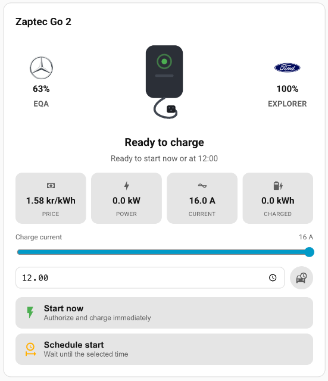
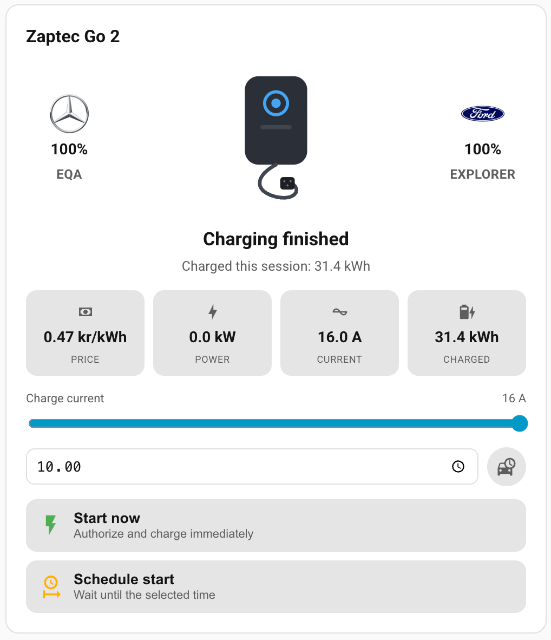
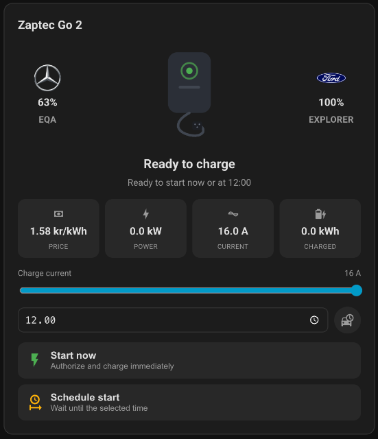
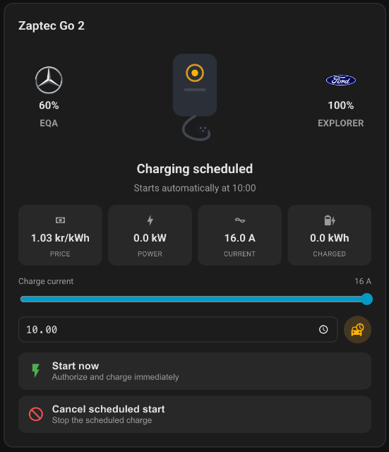
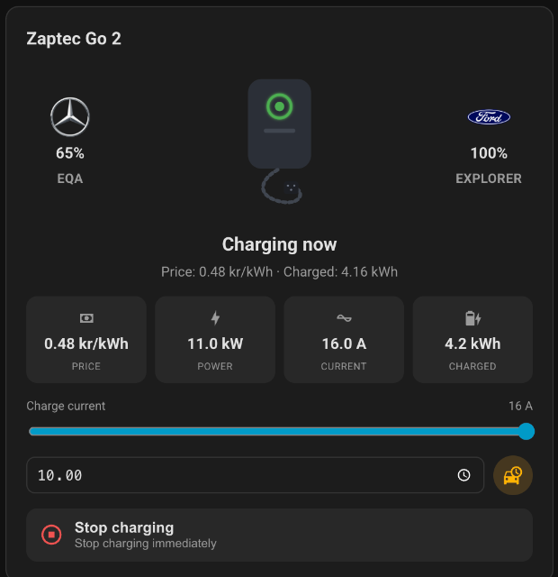
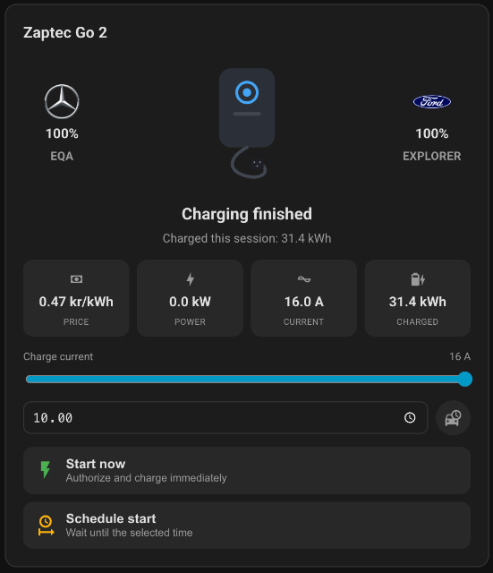

# Zaptec Go 2 Charger Card

A custom [Home Assistant](https://www.home-assistant.io/) Lovelace card for managing a Zaptec Go 2 EV charger — start, schedule, throttle and monitor charging from a single card with an animated illustration of the charger as its centerpiece.


---

## Features

- Animated CSS/SVG illustration of the Zaptec Go 2 whose glow color and animation reflect the charger's state (disconnected, ready, scheduled, charging, finished)
- Live stats: price, power (kW), current (A), and session energy charged (kWh)
- Amp-limit slider that calls `zaptec.limit_current` directly
- Start now / schedule start / cancel schedule / stop charging actions
- Time picker + toggle for the scheduled start time
- Adapts to Home Assistant light and dark themes
- Supports **Danish** and **English** (follows the HA language setting)

Since v2 the card is **self-contained**: no helpers, scripts or automations to create. It finds the
Zaptec integration's entities by itself, calls the Zaptec services directly, and keeps the scheduled
start in **one automation that the card creates and manages for you** — so the scheduled start still
fires server-side, even when no browser has the dashboard open. See [How it works](#how-it-works).

---

## Screenshots

**Light theme**

<table>
<tr>
<td align="center"><br/><sub>No car connected</sub></td>
<td align="center"><br/><sub>Ready</sub></td>
</tr>
<tr>
<td align="center"><br/><sub>Scheduled</sub></td>
<td align="center"><br/><sub>Charging</sub></td>
</tr>
<tr>
<td align="center"><br/><sub>Finished</sub></td>
<td></td>
</tr>
</table>

**Dark theme**

<table>
<tr>
<td align="center"><br/><sub>No car connected</sub></td>
<td align="center"><br/><sub>Ready</sub></td>
</tr>
<tr>
<td align="center"><br/><sub>Scheduled</sub></td>
<td align="center"><br/><sub>Charging</sub></td>
</tr>
<tr>
<td align="center"><br/><sub>Finished</sub></td>
<td></td>
</tr>
</table>

---

## Requirements

Just the [Zaptec HA integration](https://github.com/custom-components/zaptec). That's it — no helpers,
scripts or automations to create.

Optional: an electricity price sensor for the price stat (defaults to
`sensor.stromligning_current_price_vat`).

To **change the scheduled time** you need to be logged in as an HA **administrator**, because the card
writes the schedule automation. Non-admin users can still see the schedule, start/stop charging, and
turn an existing schedule on or off.

---

## How it works

**Entity auto-detection.** The card looks up the Zaptec integration's entities in the entity registry
(charger mode, charging switch, authorize button, *Authorized* sensor, session energy, charge power,
phase currents, and the installation's *Available current*). The installation device used for
`zaptec.limit_current` is detected the same way. Every entity can still be overridden in the visual
editor under *Entities* — useful if you have more than one charger (pick the charger device too).

**Buttons.**

| Action                  | What the card does                                                                                                                        |
| ----------------------- | ----------------------------------------------------------------------------------------------------------------------------------------- |
| Start now               | Turns off a pending schedule, `zaptec.limit_current` → max current, waits 2 s, presses *Authorize charging* if the charger is waiting for authorization and isn't authorized yet |
| Schedule start          | `zaptec.limit_current` → 0 A, waits 2 s, authorizes (same rule), then saves and enables the schedule automation for the chosen time      |
| Cancel scheduled start  | Turns the schedule automation off                                                                                                         |
| Stop charging           | `switch.turn_off` on the charging switch                                                                                                  |
| Schedule toggle         | Turns the schedule automation on/off                                                                                                      |
| Time picker             | Rewrites the schedule automation's trigger time (creates it switched off if it doesn't exist yet, so the time is remembered)            |
| Amp slider              | `zaptec.limit_current` with the selected current                                                                                         |

**The schedule automation.** The card writes one automation through Home Assistant's automation config
API, with the id `zaptec_charger_card_schedule_<installation device id>` and the alias
*Zaptec Charger Card – scheduled start HH:MM*. It shows up under **Settings → Automations** like any
other automation. At the scheduled time it sets the current to max (and authorizes if needed), then
switches itself off — so it runs once. Unplugging the car also switches it off. Its on/off state *is*
the card's "schedule active" state, and the time in its name is what the card shows.

Don't edit it by hand — the card overwrites it the next time you change the time. If you have two
cards for the same charger and want separate schedules, set a different `schedule_id` on each.

---

## Upgrading from v1 (helpers & scripts)

If your card config has `entity_schedule_enabled` pointing at an existing helper, the card keeps running
**exactly as in v1** (legacy mode), calling your scripts and helpers. To switch to the built-in logic:

1. Open the card editor, expand *Legacy helpers & scripts* and clear every field there
   (or delete the `entity_is_authorized`, `entity_schedule_enabled`, `entity_schedule_time`,
   `entity_deauthorize_button` and `script_*` lines from the card YAML).
2. Optionally clear the *Entities* section too, to let the card auto-detect them.
3. Pick your scheduled time once in the card — this creates the schedule automation.
4. When you're happy, delete the old helpers, the three scripts and the three automations.

---

## Installation

### Via HACS (recommended)

1. Open **HACS** in Home Assistant.
2. Go to **Frontend** → click the three-dot menu → **Custom repositories**.
3. Add `https://github.com/briis/zaptec_charger_card` with category **Lovelace**.
4. Find **Zaptec Go 2 Charger Card** in the list and click **Download**.
5. Reload your browser.

### Manual

1. Download `zaptec-charger-card.js` from the [latest release](https://github.com/briis/zaptec_charger_card/releases/latest).
2. Copy it to `/config/www/zaptec_charger_card/zaptec-charger-card.js`.
3. In Home Assistant go to **Settings → Dashboards → Resources** and add:
   ```
   URL:  /local/zaptec_charger_card/zaptec-charger-card.js
   Type: JavaScript module
   ```
4. Reload your browser.

---

## Configuration

Add the card via the UI card picker (**Zaptec Go 2 Charger Card**) or paste the YAML directly. Every option below has a default matching a typical Zaptec HA integration setup, and can be overridden through the visual editor.

Everything is optional — an empty config (`type: custom:zaptec-charger-card`) works on a standard
Zaptec install.

| Option                     | Type   | Default                                 | Description                                                                                                       |
| -------------------------- | ------ | --------------------------------------- | ----------------------------------------------------------------------------------------------------------------- |
| `type`                     | string | —                                       | `custom:zaptec-charger-card`                                                                                      |
| `device_id`                | string | auto                                    | Zaptec **installation** device, used for `zaptec.limit_current`. Device picker in the editor.                     |
| `charger_device_id`        | string | auto                                    | Zaptec **charger** device. Only needed with several chargers, to pick which one the card shows.                   |
| `entity_price`             | string | `sensor.stromligning_current_price_vat` | Live electricity price                                                                                            |
| `min_current`              | number | `6`                                     | Amp slider minimum                                                                                                |
| `max_current`              | number | `16`                                    | Amp slider maximum, and the current used by *Start now* and the scheduled start                                   |
| `title`                    | string | `Zaptec Go 2`                           | Card title                                                                                                        |
| `entity_charger_mode`      | string | auto                                    | Override: charger mode sensor                                                                                     |
| `entity_charging_switch`   | string | auto                                    | Override: charging switch (Stop charging)                                                                         |
| `entity_authorize_button`  | string | auto                                    | Override: *Authorize charging* button                                                                             |
| `entity_authorized`        | string | auto                                    | Override: *Authorized* binary sensor                                                                              |
| `entity_available_current` | string | auto                                    | Override: installation *Available current* (drives the slider position)                                           |
| `entity_session_energy`    | string | auto                                    | Override: kWh charged this session                                                                                |
| `entity_power`             | string | auto                                    | Override: charge power (W or kW)                                                                                  |
| `entity_current`           | string | auto (max of the phase currents)        | Override: live current                                                                                            |
| `schedule_id`              | string | installation device id                  | Suffix for the schedule automation's id — only to give two cards on the same charger separate schedules           |
| `left_soc_entity`          | string | —                                       | Optional sensor (%) shown left of the illustration, e.g. a car's battery state of charge. Hidden when unset.      |
| `left_soc_name`            | string | —                                       | Label shown under the left sensor's value                                                                         |
| `left_soc_icon`            | string | `mdi:car-electric`                      | Icon for the left sensor                                                                                          |
| `left_soc_image`           | string | —                                       | Optional image URL/path (e.g. `/local/car.png`). Overrides `left_soc_icon` when set.                              |
| `left_soc_color`           | string | `#03a9f4`                               | Icon color for the left sensor (any CSS color); ignored when `left_soc_image` is set                              |
| `right_soc_*`              |        |                                         | Same as `left_soc_*`, for the right side                                                                          |

Legacy (v1) options, only used in legacy mode: `entity_is_authorized`, `entity_schedule_enabled`,
`entity_schedule_time`, `entity_deauthorize_button`, `script_start_now`, `script_schedule`,
`script_cancel_schedule`. See [Upgrading from v1](#upgrading-from-v1-helpers--scripts).

### Example

```yaml
type: custom:zaptec-charger-card
max_current: 16
left_soc_entity: sensor.my_car_state_of_charge
left_soc_name: GLB
```

---

## Button visibility rules

The action buttons follow the same precedence as a typical hand-built Zaptec dashboard:

| Button                 | Shown when                                                                               |
| ---------------------- | ---------------------------------------------------------------------------------------- |
| Start now              | mode is not `disconnected` and not `connected_charging`                                  |
| Schedule start         | mode is not `disconnected`/`connected_charging`, and the schedule is not already enabled |
| Stop charging          | mode is `connected_charging`                                                             |
| Cancel scheduled start | mode is not `connected_charging`, and the schedule is enabled                            |

---

## Grid layout

| Property        | Value |
| --------------- | ----- |
| Default columns | 6     |
| Minimum         | 4 × 6 |
| Maximum columns | 12    |

---

## License

[MIT](LICENSE)
