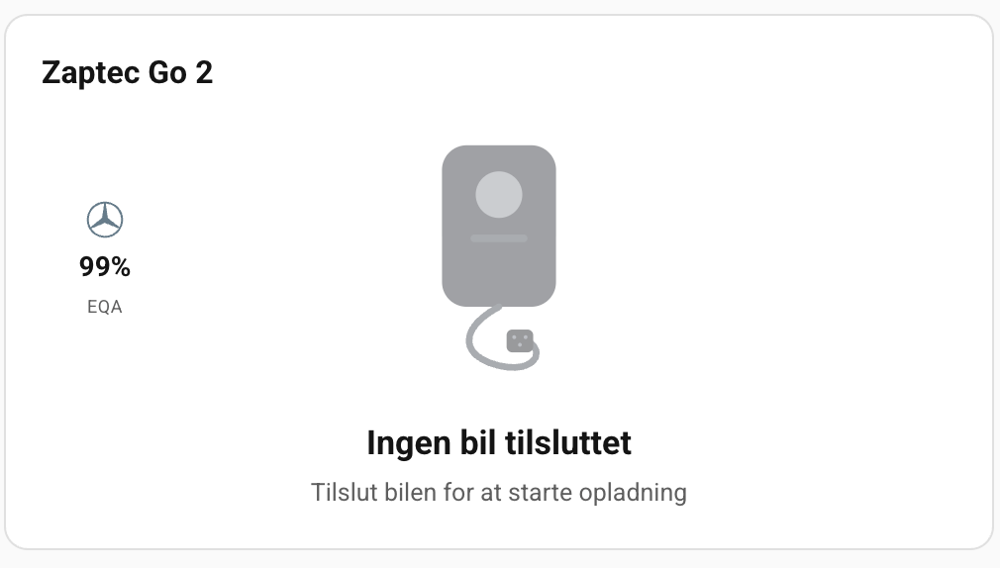
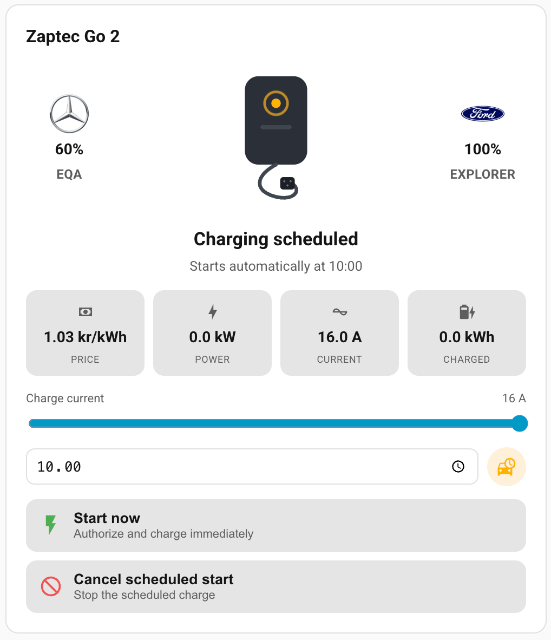
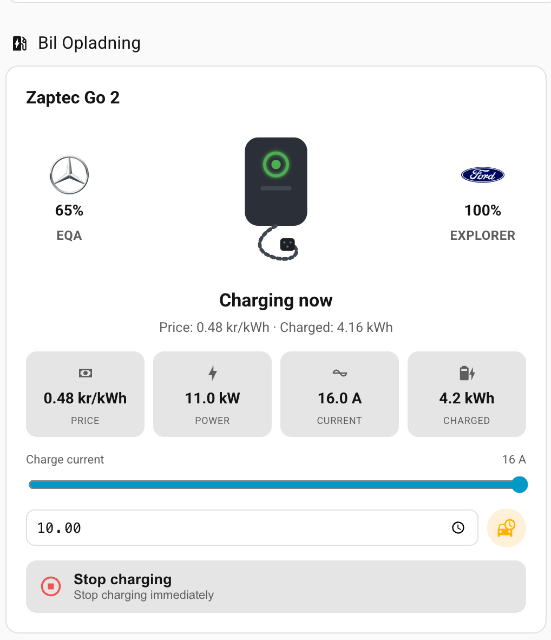

# Zaptec Go 2 Charger Card

<p align="center">
  
</p>

A custom [Home Assistant](https://www.home-assistant.io/) Lovelace card for managing a Zaptec Go 2 EV charger — start, schedule, throttle and monitor charging from a single card with an animated illustration of the charger as its centerpiece.


---

## Features

- Animated CSS/SVG illustration of the Zaptec Go 2 whose glow color and animation reflect the charger's state (disconnected, ready, scheduled, charging, finished)
- Or use your own icon or image for the charger — it gets the same state-colored glow and animations
- Live stats: price, power (kW), current (A), and session energy charged (kWh)
- Amp-limit slider that calls `zaptec.limit_current` directly
- Start now / schedule start / cancel schedule / stop charging actions
- Scheduled start that fires server-side, even when no dashboard is open — usable by every HA user
- **Zero setup**: finds the Zaptec entities by itself; no helpers, scripts or automations to create
- Shows up as a suggestion in the card picker when you pick a Zaptec entity (Home Assistant 2026.6+)
- Adapts to Home Assistant light and dark themes
- Supports **Danish** and **English** (follows the HA language setting)

Since v2 the card is **self-contained**: there are no helpers, scripts or automations for you to
create. It finds the Zaptec integration's entities by itself, calls the Zaptec services directly, and
sets up its own time helper and automation for the scheduled start the first time an admin uses it —
see [Setup](#setup-first-run). Coming from v1? See [Upgrading from v1](#upgrading-from-v1-helpers--scripts).
For what changed between versions, see the [changelog](https://github.com/briis/zaptec_charger_card/blob/main/CHANGELOG.md).

---

## Screenshots

**Light theme**

<table>
<tr>
<td align="center"><br/><sub>No car connected</sub></td>
<td align="center"><br/><sub>Ready</sub></td>
</tr>
<tr>
<td align="center"><br/><sub>Scheduled</sub></td>
<td align="center"><br/><sub>Charging</sub></td>
</tr>
<tr>
<td align="center"><br/><sub>Finished</sub></td>
<td></td>
</tr>
</table>

**Dark theme**

<table>
<tr>
<td align="center"><br/><sub>No car connected</sub></td>
<td align="center"><br/><sub>Ready</sub></td>
</tr>
<tr>
<td align="center"><br/><sub>Scheduled</sub></td>
<td align="center"><br/><sub>Charging</sub></td>
</tr>
<tr>
<td align="center"><br/><sub>Finished</sub></td>
<td></td>
</tr>
</table>

---

## Requirements

- Home Assistant with the [Zaptec integration](https://github.com/custom-components/zaptec) set up.
- An HA **administrator** account for the one-time setup of the schedule (see [Setup](#setup-first-run)).
  Everyday use works for every user.
- Optional: an electricity price sensor for the price stat (defaults to
  `sensor.stromligning_current_price_vat`; pick another one in the card editor).

---

## Installation

### Via HACS (recommended)

1. Open **HACS** in Home Assistant.
2. Go to **Frontend** → click the three-dot menu → **Custom repositories**.
3. Add `https://github.com/briis/zaptec_charger_card` with category **Lovelace**.
4. Find **Zaptec Go 2 Charger Card** in the list and click **Download**.
5. Reload your browser.

### Manual

1. Download `zaptec-charger-card.js` from the [latest release](https://github.com/briis/zaptec_charger_card/releases/latest).
2. Copy it to `/config/www/zaptec_charger_card/zaptec-charger-card.js`.
3. In Home Assistant go to **Settings → Dashboards → Resources** and add:
   ```
   URL:  /local/zaptec_charger_card/zaptec-charger-card.js
   Type: JavaScript module
   ```
4. Reload your browser.

---

## Setup (first run)

1. **Add the card.** Edit a dashboard → **Add card** → *Zaptec Go 2 Charger Card* (on Home Assistant
   2026.6+ you can also pick any Zaptec entity in the card picker — the card is suggested under
   *Community*). Leave everything
   as it is: the card finds your charger, its entities and the Zaptec installation device itself.
   You can now start/stop charging and use the amp slider.
2. **Set up the schedule — once, as an administrator.** Log in to Home Assistant with an admin account,
   connect the car, then do *one* of these in the card:
   - pick a time in the time picker, or
   - tap **Schedule start**, or
   - tap the clock (schedule) button.

   The card now creates three things, which you'll find under **Settings**:

   | What                                                      | Where                                   | Purpose                              |
   | --------------------------------------------------------- | --------------------------------------- | ------------------------------------ |
   | Time helper **Zaptec Charger Card schedule time**         | Settings → Devices & services → Helpers | Holds the scheduled start time       |
   | Number helper **Zaptec Charger Card charge current**      | Settings → Devices & services → Helpers | Remembers the charge current         |
   | Automation **Zaptec Charger Card – scheduled start**      | Settings → Automations & scenes         | Starts charging at that time         |

   If you picked a time, the schedule is created switched **off**; with *Schedule start* or the clock
   button it's switched **on** right away.
3. **Done — everyone can use it now.** From here on, all users (admin or not) can change the time,
   schedule, cancel and toggle the schedule from the card.

Until step 2 has been done, non-admin users see the time picker, the clock button and *Schedule start*
greyed out, with the tooltip *"The schedule has to be set up once by an administrator"*.

**Good to know**

- Don't rename the two helpers — the card finds them by their names. Don't edit the automation either: when
  an admin opens the card and the card's settings (e.g. *Maximum current*) no longer match it, the card
  rewrites it automatically.
- Already set up the schedule with 2.0.0-beta1? Open the dashboard once as an admin: the card adds the
  charge-current helper and updates the automation to use it.
- If you change *Maximum current* in the card editor, open the dashboard once as an admin afterwards
  so the automation is updated to the new value.
- Deleted a helper or the automation by accident? Do step 2 again — the card recreates what's missing.
- Removing the card from your dashboard doesn't remove the helpers and the automation; delete them in
  Settings if you no longer need them.

---

## Configuration

Add the card via the UI card picker (**Zaptec Go 2 Charger Card**) or paste the YAML directly. Every option below has a default matching a typical Zaptec HA integration setup, and can be overridden through the visual editor.

Everything is optional — an empty config (`type: custom:zaptec-charger-card`) works on a standard
Zaptec install.

| Option                     | Type   | Default                                 | Description                                                                                                       |
| -------------------------- | ------ | --------------------------------------- | ----------------------------------------------------------------------------------------------------------------- |
| `type`                     | string | —                                       | `custom:zaptec-charger-card`                                                                                      |
| `device_id`                | string | auto                                    | Zaptec **installation** device, used for `zaptec.limit_current`. Device picker in the editor.                     |
| `charger_device_id`        | string | auto                                    | Zaptec **charger** device. Only needed with several chargers, to pick which one the card shows.                   |
| `entity_price`             | string | `sensor.stromligning_current_price_vat` | Live electricity price                                                                                            |
| `min_current`              | number | `0`                                     | Amp slider minimum. `0` A pauses charging without ending the session.                                             |
| `max_current`              | number | `16`                                    | Amp slider maximum, and the most *Start now* and the scheduled start will use (see [charge current](#charge-current)). 16 A suits most home installations. |
| `title`                    | string | `Zaptec Go 2`                           | Card title                                                                                                        |
| `charger_icon`             | string | —                                       | Icon (e.g. `mdi:ev-station`) shown instead of the built-in charger drawing. Colored by the charger state.          |
| `charger_image`            | string | —                                       | Image URL/path (e.g. `/local/my-charger.png`) shown instead of the drawing. Overrides `charger_icon`. A transparent PNG/SVG works best — the state glow follows its outline. |
| `entity_charger_mode`      | string | auto                                    | Override: charger mode sensor                                                                                     |
| `entity_charging_switch`   | string | auto                                    | Override: charging switch (Stop charging)                                                                         |
| `entity_authorize_button`  | string | auto                                    | Override: *Authorize charging* button                                                                             |
| `entity_resume_button`     | string | auto                                    | Override: *Resume charging* button                                                                             |
| `entity_authorized`        | string | auto                                    | Override: *Authorized* binary sensor                                                                              |
| `entity_available_current` | string | auto                                    | Override: installation *Available current* (drives the slider position)                                           |
| `entity_session_energy`    | string | auto                                    | Override: kWh charged this session                                                                                |
| `entity_power`             | string | auto                                    | Override: charge power (W or kW)                                                                                  |
| `entity_current`           | string | auto (max of the phase currents)        | Override: live current                                                                                            |
| `schedule_id`              | string | installation device id                  | Gives the card its own time helper + automation — only for separate schedules on two cards for the same charger   |
| `left_soc_entity`          | string | —                                       | Optional sensor (%) shown left of the illustration, e.g. a car's battery state of charge. Hidden when unset.      |
| `left_soc_name`            | string | —                                       | Label shown under the left sensor's value                                                                         |
| `left_soc_icon`            | string | `mdi:car-electric`                      | Icon for the left sensor                                                                                          |
| `left_soc_image`           | string | —                                       | Optional image URL/path (e.g. `/local/car.png`). Overrides `left_soc_icon` when set.                              |
| `left_soc_color`           | string | `#03a9f4`                               | Icon color for the left sensor (any CSS color); ignored when `left_soc_image` is set                              |
| `right_soc_*`              |        |                                         | Same as `left_soc_*`, for the right side                                                                          |

Legacy (v1) options, only used in legacy mode: `entity_is_authorized`, `entity_schedule_enabled`,
`entity_schedule_time`, `entity_deauthorize_button`, `script_start_now`, `script_schedule`,
`script_cancel_schedule`. See [Upgrading from v1](#upgrading-from-v1-helpers--scripts).

### Example

```yaml
type: custom:zaptec-charger-card
max_current: 16
left_soc_entity: sensor.my_car_state_of_charge
left_soc_name: GLB
```

---

## How it works

**Entity auto-detection.** The card looks up the Zaptec integration's entities in the entity registry
(charger mode, charging switch, authorize button, *Authorized* sensor, session energy, charge power,
phase currents, and the installation's *Available current*). The installation device used for
`zaptec.limit_current` is detected the same way. Every entity can still be overridden in the visual
editor under *Entities* — useful if you have more than one charger (pick the charger device too).

**Buttons.**

| Action                  | What the card does                                                                                                                        |
| ----------------------- | ----------------------------------------------------------------------------------------------------------------------------------------- |
| Start now               | Turns off a pending schedule, `zaptec.limit_current` → the [charge current](#charge-current), waits 2 s, then presses *Authorize charging* if the charger is waiting for authorization, or *Resume charging* if charging was stopped |
| Schedule start          | `zaptec.limit_current` → 0 A, waits 2 s, authorizes (same rule), then turns the schedule automation on                                  |
| Cancel scheduled start  | Turns the schedule automation off                                                                                                         |
| Stop charging           | `switch.turn_off` on the charging switch                                                                                                  |
| Schedule toggle         | Turns the schedule automation on/off                                                                                                      |
| Time picker             | `input_datetime.set_datetime` on the card's time helper                                                                                  |
| Amp slider              | `zaptec.limit_current` with the selected current, and remembers it as the [charge current](#charge-current) (unless it's 0 A)         |

**The schedule: two helpers + one automation, created by the card.** The first time an admin uses the
schedule, the card creates:

- a time helper, **Zaptec Charger Card schedule time** (`input_datetime`, time only) — this holds the
  scheduled time, so changing it is an ordinary helper update anyone can make;
- a number helper, **Zaptec Charger Card charge current** (`input_number`, 0–32 A) — the
  [charge current](#charge-current);
- an automation, **Zaptec Charger Card – scheduled start** (id
  `zaptec_charger_card_schedule_<installation device id>`), triggered at the helper's time.

Both show up in Settings like any other helper/automation. The automation's on/off state *is* the
card's "schedule active" state. When it fires it sets the charge current (and authorizes, or resumes a
charger that was stopped, if needed),
then switches itself off — so it runs once. Unplugging the car while a start is scheduled also switches
it off, and sets the current back from the 0 A hold to the charge current, so the charger isn't left
blocked for a session started some other way (Zaptec app, RFID tag, another automation).

<a id="charge-current"></a>**Charge current.** Moving the amp slider applies the new limit right away
*and* stores it in the charge-current helper. *Start now* and the scheduled start then charge at that
stored value instead of always jumping back to `max_current` — set 14 A once, and every following
start uses 14 A. The rules:

- The stored value is capped at `max_current`.
- Sliding to **0 A** pauses charging but isn't stored, so the next start doesn't start at 0 A.
- Without the helper (not set up yet, or legacy mode), starts use `max_current`.
- Anyone can change it, like the time, since it's an ordinary helper.

See [Setup → Good to know](#setup-first-run) for what not to touch. If you have two cards for the
same charger and want separate schedules, set a different `schedule_id` on each (each gets its own
helper and automation).

---

## Button visibility rules

The action buttons follow the same precedence as a typical hand-built Zaptec dashboard:

| Button                 | Shown when                                                                               |
| ---------------------- | ---------------------------------------------------------------------------------------- |
| Start now              | mode is not `disconnected` and not `connected_charging`                                  |
| Schedule start         | mode is not `disconnected`/`connected_charging`, and the schedule is not already enabled |
| Stop charging          | mode is `connected_charging`                                                             |
| Cancel scheduled start | mode is not `connected_charging`, and the schedule is enabled                            |

---

## Grid layout

| Property        | Value |
| --------------- | ----- |
| Default columns | 6     |
| Minimum         | 4 × 6 |
| Maximum columns | 12    |

---

## Upgrading from v1 (helpers & scripts)

Nothing breaks when you update: if your card config has `entity_schedule_enabled` pointing at an
existing helper, the card keeps running **exactly as in v1** (legacy mode), calling your scripts and
helpers. Switch to the built-in logic when it suits you:

1. Open the card editor, expand *Legacy helpers & scripts* and clear every field there
   (or delete the `entity_is_authorized`, `entity_schedule_enabled`, `entity_schedule_time`,
   `entity_deauthorize_button` and `script_*` lines from the card YAML).
2. Optionally clear the *Entities* section too, so the card auto-detects them. Keep `device_id` if you
   had it — or clear it and let the card find the installation device.
3. Save, then do the [first-run setup](#setup-first-run) (step 2) as an administrator.
4. Check that the new schedule works, then delete the old v1 pieces: the helpers
   `input_boolean.zaptec_is_authorized`, `input_boolean.zaptec_scheduled_charge_enabled` and
   `input_datetime.zaptec_scheduled_start_time`, the three `script.zaptec_*` scripts, and the three
   Zaptec automations (authorized reset, schedule-off-when-finished, scheduled start).

> **Note:** v1's default config pointed at a specific Zaptec device id. v2 has no such default — if
> your card YAML has no `device_id`, the card now detects it instead.

---

## Troubleshooting

| Symptom                                                                 | What to do                                                                                                                                              |
| ----------------------------------------------------------------------- | ------------------------------------------------------------------------------------------------------------------------------------------------------- |
| Schedule controls are greyed out                                        | The schedule hasn't been set up yet — do [step 2 of Setup](#setup-first-run) as an administrator.                                                       |
| Toast *"Zaptec card: action failed (...)"*                              | The service call or the automation write failed; the text in brackets is Home Assistant's error. Check **Settings → System → Logs**.                    |
| A stat shows `—`                                                         | The card couldn't find that entity. Open the card editor → *Entities* and pick it manually.                                                            |
| More than one Zaptec charger                                            | Pick the *Zaptec charger* (and if needed the *Zaptec installation*) device in the card editor. Give each card its own `schedule_id` for separate schedules. |
| The card still calls my old scripts                                     | It's in legacy (v1) mode — see [Upgrading from v1](#upgrading-from-v1-helpers--scripts).                                                               |

---

## License

[MIT](https://github.com/briis/zaptec_charger_card/blob/main/LICENSE)
